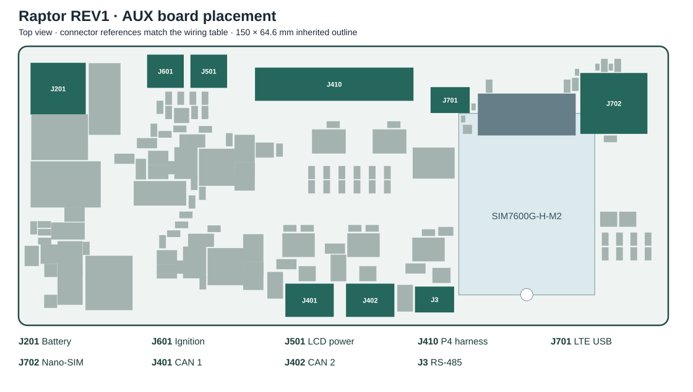

# Raptor REV1 AUX board

Open `P4-Power-and-Functions-Aux-Board.kicad_pro` in KiCad 10. The root sheet contains the vehicle protection stage. The four child sheets contain the switched supplies, bus interfaces, host harness and LTE carrier. The PCB is a placement and routing work in progress.

## Mounting on the Waveshare 8.8

The top of the AUX board faces away from the LCD. In the rear view the display ribbon exits on the right. The 150.00 × 64.60 mm PCB is centered on the 240.50 × 68.00 mm glass. The nominal margins are 45.25 mm left and right and 1.70 mm top and bottom. The locked rectangle on the Drawings layer records the glass envelope.

| Mount | From left of glass | From top of glass | From left of AUX | From top of AUX |
|---|---:|---:|---:|---:|
| H1, upper left | 83.95 | 13.50 | 38.70 | 11.80 |
| H2, upper right | 141.95 | 13.50 | 96.70 | 11.80 |
| H3, lower left | 83.95 | 62.50 | 38.70 | 60.80 |
| H4, lower right | 141.95 | 62.50 | 96.70 | 60.80 |

All dimensions are in millimeters. The four posts marked in red are M2.5, height 8 mm. They have 58.00 × 49.00 mm center spacing. H1–H4 are locked Ø2.70 mm non-plated holes. The layout reserves Ø6.40 mm at each screw for its head and standoff. Use the placement drawing at actual size to check the pattern. The card retention hole at J1 is separate.

All external cable headers mate vertically, including the Micro-Fit battery header and the JST GH headers J3 and J701. With the real LCD, check solder-tail clearance over its components, DSI and power cable access, and the mated height behind the dash. For screw selection measure usable thread depth and allow for PCB and washer thickness. The drawing specifies post height only.

[Annotated Waveshare rear and side views](../Mechanical/8.8inch%20DSI%20LCD-20241025.pdf)

## Power and key operation

J201 pin 1 accepts constant fused battery positive. Pin 2 is the battery return. Fuse the vehicle harness at its source. F201 is a second, on-board 5 A time-delay fuse. J601 pin 1 accepts a positive, ignition-switched 12 V signal and pin 2 its return. Select a feed that goes low at key-off. Both returns connect to board ground.

U201 retains the LM74800-Q1 input protection, two series MOSFETs, the bidirectional TVS and input filter. Its nominal falling and rising undervoltage thresholds are 7.49 V and 8.15 V, with overvoltage cutoff around 20.18 V. U201 and its dividers remain powered while parked. R605/R606 limit ignition LED current, D601 protects its reverse junction, and U602 enables both bucks using the protected battery rail. The P4 and modem can restart after cranking.

| Rail | Load and design target |
|---|---|
| U501, nominal 5.016 V | Budget 3 A **total** for P4, LCD, CAN and local 3.3 V loads. The LM76003-Q1 has a 3.5 A rating. The regulator and cable still need thermal and voltage-drop tests. |
| J410 pin 1, HOST_5V | U502 is a TPS259470A reverse-blocking eFuse. Its nominal 3.18 A threshold protects the host branch. It does not add current to the 3 A system budget. |
| J501 pin 1, SYS_5V | Independent 5 V and ground feed for the Waveshare 8.8-inch LCD. Use its existing DSI cable to the P4 and one display power cable to J501. Pin 2 is ground. |
| U503, 3.3 V | Supplies AUX interface logic. The HE1 Lite direct harness uses the host's own 3.3 V. |
| U601, nominal 3.803 V | Independent LTE rail with five VBAT contacts, all eleven card grounds and local 220 µF polymer bulk. Budget 2.5 A burst. |

At 3 A on 5 V and 2.5 A on 3.8 V the output power is 24.5 W. Assuming 85% conversion efficiency, this corresponds to 2.4 A at 12 V and 3.6 A at 8 V. Fuse temperature derating, wire losses and startup pulses need a physical check. Waveshare lists the maximum LCD current as TBD. Measure panel current at maximum brightness with the P4, radios and audio active. Verify at least 4.75 V at the display connector and scope the modem socket during a transmit burst. The proposed targets are 3.4–4.2 V at the modem and 3 A or less combined on the 5 V converter.

[Waveshare 8.8-inch LCD](https://www.waveshare.com/wiki/8.8-DSI-TOUCH-A) · [LM74800-Q1](https://www.ti.com/product/LM7480-Q1) · [LM76003-Q1](https://www.ti.com/product/LM76003-Q1) · [TPS25947](https://www.ti.com/product/TPS25947)

## Raptor WIFI6-DB harness

The U10 numbers below are the **physical Pico-format header numbers in the Waveshare schematic**. GP labels inside Waveshare's Pico drawing differ from the GPIO nets connected outside it. Use the GPIO column for firmware. The AUX side is a Molex SL 171971-0013. Identify cavity 1 from the manufacturer mark on each housing. The two ground wires and reference-supply wire are part of the harness.

| J410 | AUX net | WIFI6-DB U10 | ESP32-P4 signal |
|---:|---|---:|---|
| 1 | HOST_5V | 39 | VSYS / VCC_5V |
| 2 | GND | 38 | Power return |
| 3 | P4_3V3_REF | 36 | Host 3.3 V output to U411 and host-side pulls |
| 4 | P4_CAN1_TX | 35 | GPIO20, TWAI channel 1 TX |
| 5 | P4_CAN1_RX | 34 | GPIO21, TWAI channel 1 RX |
| 6 | P4_CAN2_TX | 32 | GPIO22, TWAI channel 2 TX |
| 7 | P4_CAN2_RX | 31 | GPIO23, TWAI channel 2 RX |
| 8 | GND | 28 | Signal return |
| 9 | P4_RS_TX | 29 | GPIO26, RS-485 UART TX |
| 10 | P4_RS_RX | 27 | GPIO27, RS-485 UART RX |
| 11 | P4_RS_DE | 26 | GPIO32, high to transmit |
| 12 | P4_MODEM_RUN | 25 | GPIO33, high to start LTE |
| 13 | P4_BUCK6_PG | 24 | GPIO46, LTE rail power good |

Use a mating socket strip that spans the required U10 pins on the 21–40 row, including empty cavities. Leave U10 pin 40 unpopulated. Choose crimps, contacts and wire gauge for actual branch current, harness length and ambient temperature. The Nano requires its own host-side harness and a separate power-path check.

**HE1 Lite** can plug directly into the other P4 header row. Allocate U10 pins 4/5/6/7 to SCLK/MOSI/MISO/CS respectively (GPIO31/30/29/28). Use U10 pin 8 for return and branch the host 3.3 V from U10 pin 36. The physical numbers on the HE1 connector depend on the sensor PCB. Verify polarity and SPI edges at the sensor over the installed shifter cable.

[Waveshare host schematic and resources](https://docs.waveshare.com/ESP32-P4-WIFI6-DB/Resources-And-Documents) · [ESP32-P4 pin guidance](https://docs.espressif.com/projects/esp-hardware-design-guidelines/en/latest/esp32p4/schematic-checklist-esp32p4.html)

## USB and vehicle interfaces

On the reviewed WIFI6-DB schematic, H2 programming USB-C VBUS connects to USB0_5V and U10 pin 40. U10 pin 39 is VCC_5V on the board side of Q2 (AO3401) and its U2 dual-PNP control. The AUX feeds pin 39 through its own reverse-blocking U502. Because Q2 is on the stock board, U502 alone cannot establish laptop-side reverse current. For initial dual-source tests use a current-limited USB source and measure both current direction and VBUS. Test USB alone, ignition alone, both sources and key-off with USB present. Include display FFC, touch and backlight connections when checking rail injection. With USB only, the host reference powers U411. U410 and U411 use partial-power-down tolerant buffers. Measure AUX 5 V, 3.3 V, LTE VBAT and current into the vehicle feed.

- **LTE USB** uses the host's separate P1 four-pin HS header. Use a short shielded USB harness with a 90 Ω differential pair. P1 pin 2 to J701 pin 2 is D−, P1 pin 3 to J701 pin 3 is D+, and P1 pin 4 to J701 pin 4 is ground. Omit pin 1 at both ends. The modem takes power at J1 from U601. A matching pitch alone does not establish mating compatibility between connector families.
- **CAN** uses the P4's native Classical CAN controllers. J401 and J402 each use pins 1/2/3 for CANH/CANL/GND. Fit JP411 or JP412 only if that port is a bus end. For the Haltech bus use 1 Mbit/s. Both transceivers start recessive.
- **RS-485** uses J3 pins 1/2/3 for ground, U2 A (noninverting) and U2 B (inverting). Pin 4 is open. Match the accessory using polarity or its datasheet. Fit JP413 only at a bus end. Driver enable defaults low.
- **SIM** uses J702, a hinged nano-SIM holder. Insert the SIM with power off. J1 includes a mounting hole at the inherited 40.2 mm offset. The SIMCom card is 42.0 × 31.4 mm. Check screw, standoff height and antenna cable clearance with the actual hardware before fabrication.

[TCAN1042V-Q1](https://www.ti.com/product/TCAN1042V-Q1) · [74LVC125A power-off behavior](https://assets.nexperia.com/documents/data-sheet/74LVC125A.pdf) · [SIMCom M.2 module](https://en.simcom.com/product/SIM7600X-H-M2.html)

## Modem startup and cutoff

Firmware must configure GPIO33 low by default. Wait for GPIO46 power-good and at least 100 ms of stable VBAT before asserting RUN. After any shutdown command, SIMCom specifies at least 30 s before another start. Use a conservative 30 s delay following a host restart if the elapsed time is unknown. When operating with laptop USB attached, clear RUN when power-good falls and keep it low through the next stabilization interval. Q701/Q702 source the card's run command from its own VBAT. Key-off removes VBAT as specified for hardware cutoff in section 3.2.2. The Raptor design has no parking timer. TP701 exposes the card's wake output for measurement.

[SIMCom M.2 hardware design V1.03, sections 3.1–3.2](https://mt-system.ru/upload/iblock/613/01rcmn9veiov1qdci5zk1sih4p2gv1ua.pdf)

## Layout and verification

The board uses the registered LCD mounting pattern and four-layer stack with an L2 ground plane. The placement preserves the vehicle protection copper and reuses compatible regulator routes from the display daughterboard. The modem USB pair runs on F.Cu directly through the two ESD signal lands and references L2. Route the 5 V and LTE feeds as copper sized for their load, keeping the branches short and the switch nodes compact. For USB, obtain the manufacturer's 90 Ω differential geometry against L2 and verify the routed pair. The 0.15 mm trace and gap entries in the project are provisional. The minimum 0.15 mm copper spacing accommodates the TI package escapes. Use the full current-carrying width or copper pours outside the escapes.

KiCad 10.0.8 reports zero ERC errors or warnings, 145 PCB footprints, zero schematic parity findings and zero DRC geometry violations at this placement. DRC separately reports **320 unconnected items**. Complete routing, rerun DRC including connectivity and parity, then validate power, temperature, modem transmit droop and USB power transitions on the bench.
